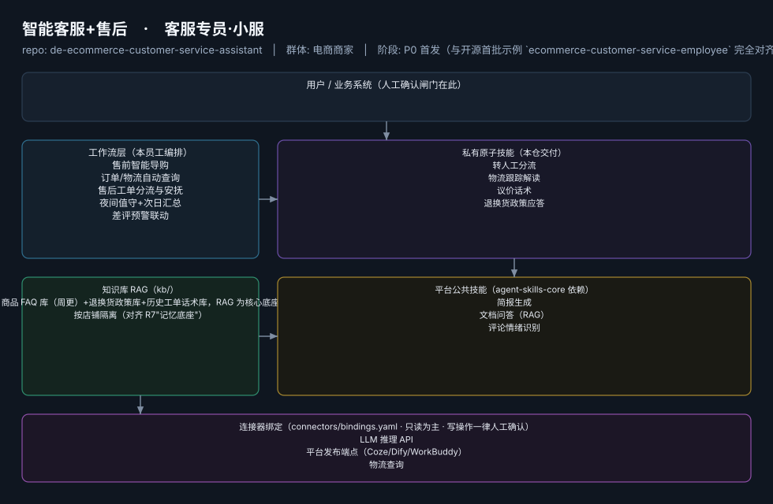
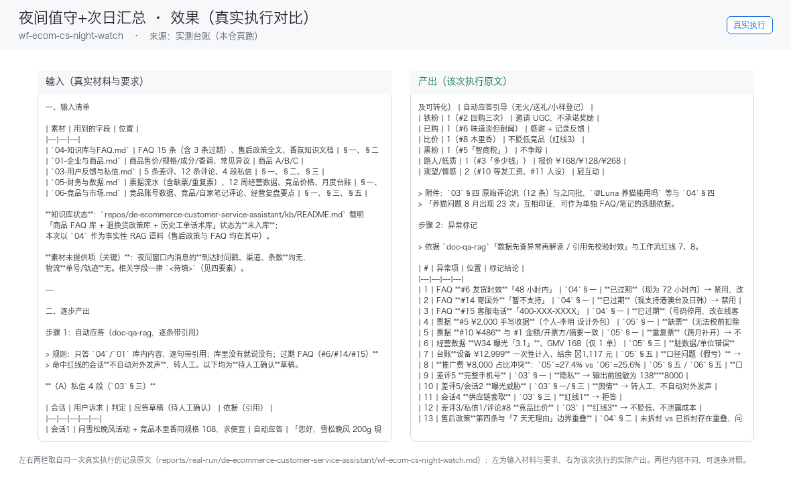

# 智能客服+售后

> 客服专员·小服 ｜ 一人店的 7×24 客服坐席
>
> **客服专员·小服**　·　电商商家　·　阶段 P0 首发（与开源首批示例 `ecommerce-customer-service-employee` 完全对齐）　·　
> 复杂度 M　·　30-60 元/月（店小蜜已验证按通计费，据R3调研）　·　定义卡 6.4-②

## 演示（真实执行录播）


*真实执行回放（GIF 自动循环，非摆拍）· [▶ 观看完整版 MP4](workflows/wf-ecom-cs-night-watch/docs/images/08-demo-run.mp4) · 台账见 [`reports/real-run/wf-ecom-cs-night-watch.md`](reports/real-run/wf-ecom-cs-night-watch.md)*



## 效果（真实执行）



*上图为**真实效果对比**，不是示意图：左栏是输入材料与要求，右栏是该次执行的产出原文，
两栏取自同一次真实执行记录。*

- 完整台账：[`reports/real-run/wf-ecom-cs-night-watch.md`](reports/real-run/wf-ecom-cs-night-watch.md)
- 录屏与终端回放：[`workflows/wf-ecom-cs-night-watch/docs/images/`](workflows/wf-ecom-cs-night-watch/docs/images/)（`08-demo-run.gif` / `08-demo-run.mp4` / `04-terminal-run.png`）
- 使用示例：[`workflows/wf-ecom-cs-night-watch/docs/使用示例.md`](workflows/wf-ecom-cs-night-watch/docs/使用示例.md)
> 实测判定：**通过**　·　可用度 4/5　·　编造数字 0 处　·　红线命中 8 次 / 拦截 8 次


**一句话**：日均咨询 30-300 条、跨 2 个以上平台的一人店

---

## 这个数字员工解决什么问题

客服专员·小服 ｜ 一人店的 7×24 客服坐席

| 项 | 内容 |
|---|---|
| 服务对象 | 日均咨询 30-300 条、跨 2 个以上平台的一人店 |
| 可量化目标 | 首响 ≤30 秒；AI 解决率 ≥70%；夜间承接率 100%；转人工率 ≤25% |
| 投入产出 | 月省客服工时约 60h≈¥1800 vs 月费 ≤¥60 |
| 需求依据 | D08、D07 |
| 分发渠道 | GitHub（开源标杆资产）、Coze扣子商店（Bot 直接上架）、小红书、抖音 |

## 30 秒上手

```bash
git clone <本仓库地址> && cd de-ecommerce-customer-service-assistant
pip install pyyaml
python3 tests/run.py            # 先跑一遍自检，确认环境与契约都对得上
```

试用（把 `<输入>` 换成本人真实材料）：

```text
请以「智能客服+售后」的身份，帮我跑「售前智能导购」。
材料如下：<输入>
要求：只使用材料里出现过的数字，缺的写 <待填>；对外文案停在待确认状态。
```

详细接入见 [`docs/01-安装与接入.md`](docs/01-安装与接入.md)。

## 仓库结构

```text
de-ecommerce-customer-service-assistant/
├── employee.md            # 人读定义卡（12 主字段 + 2 扩展组，由 employee.yaml 生成）
├── employee.yaml          # 机器契约（能力清单 + 依赖锁）
├── dependencies.yaml      # 对 core 的外部依赖（含版本）
├── persona/               # 运行提示词 / 边界 / KPI
├── skills/                # 私有原子技能（4 个）
├── spec-bindings/         # 有意不公共化能力的本地绑定声明（0 个）
├── workflows/             # 本员工工作流（5 条）
├── kb/                    # 知识库 RAG 契约
├── connectors/            # 连接器绑定（只读为主，写操作人工确认）
├── docs/                  # 六类发布文档
└── tests/                 # 自动化多场景测试
```

## 私有原子技能（4）

| 技能 | slug | 复杂度 | 阶段 | 成熟度 |
|---|---|---|---|---|
| `转人工分流` | `handoff-to-human` | S | P0 | 已实现 |
| `物流跟踪解读` | `logistics-tracking-reader` | M | P0 | 契约完备 |
| `议价话术` | `negotiation-copy` | S | P0 | 契约完备 |
| `退换货政策应答` | `return-policy-answer` | S | P0 | 契约完备 |

## 平台公共技能依赖（3）

| 技能 | slug | 全平台复用员工数 |
|---|---|---|
| `简报生成` | `brief-generator` | 10 |
| `文档问答（RAG）` | `doc-qa-rag` | 3 |
| `评论情绪识别` | `review-sentiment-tag` | 5 |

> 这些技能来自 `agent-skills-core@1.0.0`，本仓库**只引用不复制**。

## Spec 绑定层（0）

（无）

> 这一族能力**有意不公共化**（与外部平台接口强绑定）。本仓不存正文，
> 只留本地绑定声明与连接器配置。

## 工作流（5）

| 工作流 | slug | 触发 | 阶段 | 调用技能数 |
|---|---|---|---|---|
| `售前智能导购` | `wf-ecom-cs-presale-guide` | 事件（买家消息） | P0 | 2 |
| `订单/物流自动查询` | `wf-ecom-cs-logistics` | 事件 | P0 | 1 |
| `售后工单分流与安抚` | `wf-ecom-cs-after-sale-triage` | 事件 | P0 | 2 |
| `夜间值守+次日汇总` | `wf-ecom-cs-night-watch` | 定时（22:00-8:00 + 8:30 晨报） | P0 | 2 |
| `差评预警联动` | `wf-ecom-cs-review-linkage` | 事件（新评价） | P1 | 1 |

## 知识库与连接器

- 知识库语料：['商品 FAQ 库（周更）+退换货政策库+历史工单话术库，RAG 为核心底座', '按店铺隔离（对齐 R7"记忆底座"）']
- 连接器：LLM 推理 API、平台发布端点（Coze/Dify/WorkBuddy）、物流查询、平台评价读取、RAG 知识检索

## 质量与验收

| 项 | 值 |
|---|---|
| 技能文件数 | 235 |
| 多场景用例数 | 256 |
| 用例通过 | 256 |
| 验收结论 | ✅ 通过 |

完整报告：[`docs/05-验收与测试.md`](docs/05-验收与测试.md)

## 许可

专有许可，详见 [`LICENSE`](LICENSE)。
