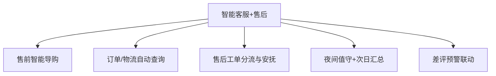

# 数字员工定义卡：智能客服+售后

> 遵循 [小班底数字员工资产规范](https://github.com/xiaobandi/digital-employee-spec) v1.0（12 主字段 + 2 扩展组）
> 本卡为人读快照，机器契约以 [`employee.yaml`](employee.yaml) 为准。

## A. 身份定义

| 字段 | 内容 |
|------|------|
| 名称 | **智能客服+售后** |
| 别名 / 旧名存档 | 客服专员·小服 |
| 一句话定位 | 客服专员·小服 ｜ 一人店的 7×24 客服坐席 |
| 目标用户 | 日均咨询 30-300 条、跨 2 个以上平台的一人店 |
| 所属客群 | 电商商家 |
| 仓库 | `de-ecommerce-customer-service-assistant` |
| 定义卡编号 | 6.4-② |
| 版本 | 1.0.0 |
| 阶段 | P0 首发（与开源首批示例 `ecommerce-customer-service-employee` 完全对齐） |
| 复杂度 | M |

## B. 角色边界（做 / 不做）

| 做 | 不做 |
|----|------|
| 售前导购、订单物流查询、售后安抚、夜间值守 | 退款审批、赔付决策（一律转人工） |

## C. 目标与 KPI

首响 ≤30 秒；AI 解决率 ≥70%；夜间承接率 100%；转人工率 ≤25%

## D. 工程与商业属性

| 字段 | 内容 |
|------|------|
| 评分 | 高频5｜痛点5｜客单价3｜广度5｜价值5 ＝ **23/25** |
| 定价 | 30-60 元/月（店小蜜已验证按通计费，据R3调研） |
| 投入产出（ROI） | 月省客服工时约 60h≈¥1800 vs 月费 ≤¥60 |
| 分发渠道 | GitHub（开源标杆资产）、Coze扣子商店（Bot 直接上架）、小红书、抖音 |

## E. System Prompt

```text
"仅依据商品知识库与退换货政策应答；不承诺规则外赔付；情绪升级或退款请求立即转人工"
```

> 完整运行提示词见 [`persona/system-prompt.md`](persona/system-prompt.md)。

## F. 工作流清单（5 条）



| # | 工作流 | 名称 | 触发方式 | 阶段 | 调用技能 |
|---|--------|------|---------|------|---------|
| 1 | `wf-ecom-cs-presale-guide` | 售前智能导购 | 事件（买家消息） | P0 | doc-qa-rag、negotiation-copy |
| 2 | `wf-ecom-cs-logistics` | 订单/物流自动查询 | 事件 | P0 | logistics-tracking-reader |
| 3 | `wf-ecom-cs-after-sale-triage` | 售后工单分流与安抚 | 事件 | P0 | review-sentiment-tag、handoff-to-human |
| 4 | `wf-ecom-cs-night-watch` | 夜间值守+次日汇总 | 定时（22:00-8:00 + 8:30 晨报） | P0 | doc-qa-rag、brief-generator |
| 5 | `wf-ecom-cs-review-linkage` | 差评预警联动 | 事件（新评价） | P1 | review-sentiment-tag |

**步骤链路**：`wf-ecom-cs-presale-guide`：意图识别→知识库检索→话术→商品推荐；`wf-ecom-cs-logistics`：单号识别→物流接口→状态解读回复；`wf-ecom-cs-after-sale-triage`：情绪识别→分级→安抚话术/转人工；`wf-ecom-cs-night-watch`：自动应答→异常标记→晨报推送；`wf-ecom-cs-review-linkage`：情感分析→安抚话术推送店主

## G. 技能清单（4 个私有）

| 技能 | 名称 | 成熟度 | 版本 |
|------|------|--------|------|
| `handoff-to-human` | 转人工分流 | implemented | 1.0.0 |
| `logistics-tracking-reader` | 物流跟踪解读 | contract-complete | 1.0.0 |
| `negotiation-copy` | 议价话术 | contract-complete | 1.0.0 |
| `return-policy-answer` | 退换货政策应答 | contract-complete | 1.0.0 |

### 共享技能（挂载自公共底座）

| 技能 | 来源仓 | 版本 |
|---|---|---|
| `brief-generator` | agent-skills-core | 1.0.0 |
| `doc-qa-rag` | agent-skills-core | 1.0.0 |
| `review-sentiment-tag` | agent-skills-core | 1.0.0 |

## H. 知识库与连接器

| 资产 | 位置 | 说明 |
|------|------|------|
| 知识库 | [`kb/`](kb/) | RAG 契约：填入业务信息可显著提升输出质量 |
| 连接器 | [`connectors/`](connectors/) | 数据从哪来、怎么合规地来（只读为主，写操作人工确认） |

## I. 需求溯源

| 字段 | 内容 |
|------|------|
| 需求编号 | D08、D07 |
| 需求支持度 | 充分 |
| 证据置信度 | 中 |

## J. 可信三字段

| 字段 | 值 |
|------|-----|
| 需求支持度 | 充分 |
| 证据置信度 | 中 |
| 使用边界 | 见 B 段（做 / 不做） |

---

*本卡由 `tools/upgrade_facade.py` 依定义卡规范自动生成，请勿手工编辑；改 `employee.yaml` 后重跑即可刷新。*
